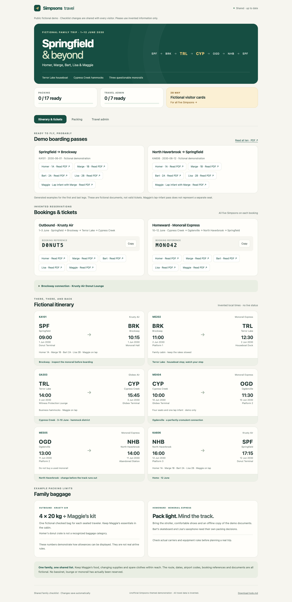

# The Simpsons’ Great Escape

A small, self-hosted family travel dashboard with a shared packing checklist, travel-admin tasks, itinerary cards, booking references, ticket downloads and boarding passes. The sample family is **Homer, Marge, Bart, Lisa and Maggie Simpson**. All dates, routes, airport codes, carriers, booking references and PDFs are invented.

The app uses **Python’s standard library and plain HTML/CSS/JavaScript**. There are no API keys, npm packages, database servers, analytics, external fonts or account registrations required to run it.



[Mobile screenshot](docs/demo-mobile.png)

## Live demo

**[Try it on lalten.org](https://lalten.org/simpsons-travel/).** No Tailscale or login is needed. This is a public, shared fictional demo: checklist changes are visible to every visitor. Use invented information only. The code repository and the running website have independent visibility settings.

Deployment details and the checked-in service/proxy templates are in [deploy/README.md](deploy/README.md).

## The route

**Springfield → Brockway → Terror Lake → Cypress Creek → Ogdenville → North Haverbrook → Springfield**

| Place | Demo code | Reference |
| --- | --- | --- |
| Springfield | SPF | The Simpsons’ home |
| Brockway | BRK | One of the towns in *Marge vs. the Monorail* (S4E12) |
| Terror Lake | TRL | The houseboat town in *Cape Feare* (S5E2), including the rake gag |
| Cypress Creek | CYP | Hank Scorpio’s company town in *You Only Move Twice* (S8E2) |
| Ogdenville | OGD | Another town from the monorail pitch |
| North Haverbrook | NHB | The third monorail town; things did not go well |

The six demo legs run from **1–12 June 2030**. “Krusty Air,” “Globex Air” and “Monorail Express” are fictional demo carriers. The displayed terminal names, timings, lounge and baggage details are not travel advice. Every generated PDF is labelled **FICTIONAL SAMPLE — NOT VALID FOR TRAVEL**.

## Quick start

Requires Python **3.10+**. Start from the repository root:

```sh
python3 -B server.py
```

Open **http://127.0.0.1:8080/**.

On first startup the app creates `demo-data/` with its fictional state and PDFs. Restarting preserves checkmarks and custom additions. Running the seed script again also preserves existing state:

```sh
python3 -B seed.py
```

Use a different data directory or port:

```sh
python3 -B server.py --data ./another-demo --port 8091
```

The server binds **127.0.0.1 only**. It does not become publicly reachable merely because it is running.

## What works

- **Itinerary:** six transport legs, local departure/arrival times, terminals, seat notes and connection/stay notes.
- **Reservations:** two booking cards with copyable fictional references and one sample ticket per family member: ten tickets total.
- **Boarding passes:** per-person downloads for the first and last legs: ten passes and one ten-page combined PDF. Intermediate legs deliberately have no issued boarding-pass samples.
- **Packing:** grouped checklists, progress indicators, search and hide-completed filtering.
- **Travel admin:** a separate checklist with dated tasks. Ticking the visitor-card task also updates the checkbox in `todo.md`. No form is submitted.
- **Custom additions:** add and remove your own packing/admin items. Built-in examples can be checked but not deleted from the UI.
- **Shared state:** browser clients poll every five seconds and on reconnect/foreground activation. Changes persist across restarts.
- **Exports:** download the current shared checklist as Markdown, plus the admin note and generated PDFs.
- **Responsive layout:** desktop and mobile screens; printable itinerary/checklist views.

This is a shared household dashboard, not an airline booking system. It does not track live flights, submit travel documents, send reminders, create reservations or provide an offline-editing queue. Previously downloaded PDFs can be opened offline. Saving checklist changes requires a connection to the server.

## Data and files

```text
server.py                  HTTP routes, mutation validation, persistence and exports
seed.py                    Fictional state and dependency-free PDF generation
static/index.html          Simpsons-themed layout and explanatory copy
static/app.js              Rendering, checklist interactions and five-second refresh
static/style.css           Responsive and print styles
static/icon.svg            Code-native travel icon
tests.py                   Isolated HTTP/persistence/PDF tests
qa.mjs                     Optional browser checks against disposable demo data
docs/                      Screenshots of the fictional demo
verification.json          Checks performed for this version

demo-data/                 Generated locally; excluded from Git
  travel-app.json           Authoritative trip and checklist state
  todo.md                   Visitor-card checkbox mirror
  outbound-*.pdf            Five invented outbound tickets
  return-*.pdf              Five invented homeward tickets
  boarding-*.pdf            Ten invented boarding passes
  all-demo-boarding-passes.pdf
```

No original passenger records, booking documents, private hostnames, local vault paths or private repository history are included. Sample documents are generated from the fictional constants in `seed.py`; the initializer never reads an existing travel archive or extracts text from personal PDFs.

### State shape

`travel-app.json` is the authoritative state. A simplified example:

```json
{
  "revision": 1,
  "updatedAt": null,
  "trip": {
    "title": "The Simpsons’ Great Escape",
    "dates": "1–12 June 2030",
    "people": ["Homer", "Marge", "Bart", "Lisa", "Maggie"],
    "bookings": [],
    "flights": [],
    "boardingPasses": {"bundle": "all-demo-boarding-passes.pdf", "flights": []}
  },
  "items": [{
    "id": "visitor-cards",
    "text": "File fictional visitor cards for all five Simpsons",
    "section": "admin",
    "group": "Before departure",
    "done": false,
    "source": "demo",
    "due": "2030-05-28"
  }]
}
```

See `seed.py` for complete booking, flight, ticket and boarding-pass records. Those arrays are shortened above to explain the shape; that excerpt is not a replacement ready-to-run database.

### Customize the demo

For another fictional trip, edit `seed.py` and the corresponding presentation text in `static/index.html`, then initialize a **new** data directory. Some descriptive hero/baggage/lounge text is deliberately static, while booking cards, flights, pass links and checklists are state-driven. Changing only the state file will not update all static presentation text.

The default sample supports five family members, but the rendering is list-driven rather than fixed to five people. Download labels and static descriptive copy should be updated if you change the number of documents or people.

Back up your data directory before manual changes. Stop the server before editing live state by hand; simultaneous manual edits are not supported. Do not put sensitive trip data inside a public checkout or commit it. The default data directory is ignored by Git, but an arbitrary custom directory will need its own ignore/backup policy.

## Private-network hosting

A private-network reverse proxy is optional. For example, if Tailscale is already installed, start the loopback app with an additional trusted origin matching **your own** tailnet hostname:

```sh
python3 -B server.py --port 8080 \
  --origin http://your-machine.your-tailnet.ts.net
```

Then mount it on a private Tailscale Serve route:

```sh
tailscale serve --bg --http=80 --set-path=/apps/travel http://127.0.0.1:8080
```

Open `http://your-machine.your-tailnet.ts.net/apps/travel/`. Replace the hostname with your real tailnet name. The app accepts both `/` and `/apps/travel/`, so no frontend build or URL rewriting is needed. `--origin` can be repeated for multiple exact browser origins. Use your proxy’s actual scheme, hostname and port; do not add paths or trailing slashes to origins.

This example uses **Serve, not Funnel**. Inspect `tailscale serve status` before and after changing routes on an existing host. Serve mounts can replace an existing handler at the same path, so choose a separate host or adapt the prefix if `/apps/travel` is already in use. For an HTTPS proxy, pass the matching `https://…` origin instead.

For an always-on deployment, run the command through your operating system’s service manager (systemd, launchd or equivalent), keep the same `--data` path, and arrange a backup of that directory. This repository does not install or alter system services automatically.

## Security and operational boundaries

- The app has **no login or per-person permissions**. Every allowed network user shares full checklist access. Authentication/access control belongs at your private network or reverse proxy.
- Mutation requests require an allowlisted `Origin`, JSON content type and `X-Travel-App: 1`. Cross-origin browser writes are rejected. These checks are a browser-CSRF defense, **not an authentication system**; a non-browser client can supply headers.
- The server serves only known static files, generated exports and ticket/pass filenames explicitly present in the current state. It is not a general file browser.
- Checklist mutations are serialized under a process lock and saved with a flushed temporary file plus atomic rename. Do not run multiple server processes against the same data directory; the lock is process-local.
- Browser text is escaped before rendering. Security headers include a restrictive Content Security Policy, no-referrer policy and MIME-sniffing protection.
- Each successful mutation increases a revision number. Checkbox operations set an explicit state; concurrent edits to the same item use last-accepted-write semantics, not a conflict-resolution protocol.
- The visitor checkbox and `todo.md` mirror are separate writes. Startup resynchronizes the mirror from authoritative JSON if interrupted between them.
- Requests and booking-reference contents are not written to application access logs. Production supervision may still log process startup or failures.
- This single-process standard-library server is intended for a small trusted household deployment. Add real authentication, HTTPS and suitable hosting controls before considering any public deployment with sensitive data.

## API

| Method | Path | Purpose |
| --- | --- | --- |
| GET | `/health` | Liveness probe |
| GET | `/api/state` | Trip, references, download manifest and current checklist |
| POST | `/api/items` | Add a custom item, set a checkbox or remove a custom item |
| GET | `/export/checklist.md` | Current grouped Markdown checklist |
| GET | `/todo.md` | Admin-note checkbox mirror |
| GET | `/tickets/<listed-name>.pdf` | Allowlisted sample ticket |
| GET | `/boarding-passes/<listed-name>.pdf` | Allowlisted pass or bundle |

The same routes work under `/apps/travel`. Example mutation for the default local port:

```sh
curl http://127.0.0.1:8080/api/items \
  -H 'Origin: http://127.0.0.1:8080' \
  -H 'Content-Type: application/json' \
  -H 'X-Travel-App: 1' \
  --data '{"action":"toggle","id":"visitor-cards","done":true}'
```

Other bodies are `{"action":"add","text":"Spare donut","section":"packing"}` and `{"action":"remove","id":"<custom-item-id>"}`. Built-in items cannot be removed by this endpoint. JSON bodies are capped at 8 KiB; custom text at 500 characters; the checklist at 500 entries.

## Verification

Run the dependency-free test suite:

```sh
python3 -B tests.py
```

It starts its own temporary server/data directory and does not touch another running instance. It checks sample initialization, all download routes, PDF page counts, checklist updates/exports, visitor-card synchronization, input validation, CSRF defenses and state persistence after restart.

Optional browser verification requires an existing Node.js installation, Playwright and Chrome/Chromium. There is no browser-test dependency in the running app. Install Playwright in a separate disposable tools directory, not the runtime data directory, or use an existing installation:

```sh
# Terminal 1: choose a NEW disposable data directory
python3 -B server.py --data ./qa-output/data --port 18080

# Terminal 2: point to your installed Playwright ESM module and browser
PLAYWRIGHT_MODULE=/absolute/path/to/playwright/index.mjs \
CHROME_PATH=/absolute/path/to/chrome \
QA_OUTPUT=./qa-output/screenshots \
node qa.mjs
```

Browser QA is restricted to localhost port 18080 to avoid changing a live deployment. It exercises both desktop/mobile layouts, shared updates between two browser contexts, copy, search, custom items, downloads and admin-note synchronization. It removes its temporary checklist additions before exit. Test results and screenshots belong in the ignored `qa-output/` directory.

## Attribution

This is an unofficial fan-themed software demonstration. *The Simpsons*, its characters and locations belong to their respective rights holders. No official artwork, episode footage or endorsement is included. The UI icon and PDF examples are generated by the code in this repository. References to the television series provide the fictional setting only.
